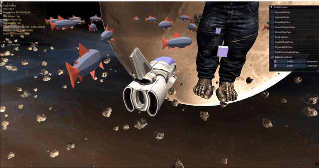
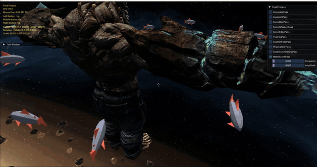
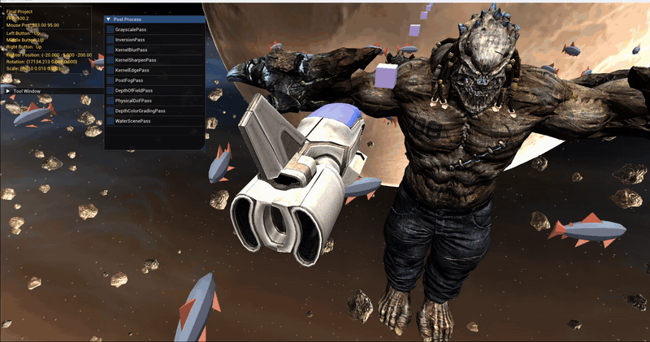
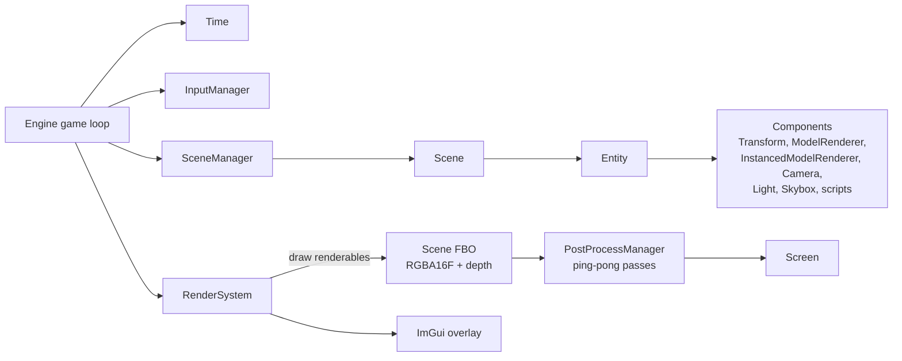
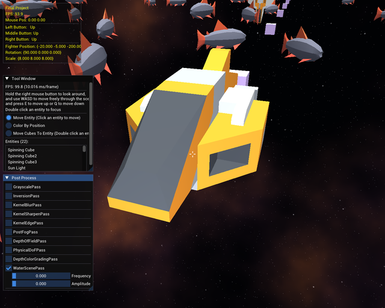

# OpenGL Game Engine

A small 3D game engine written from scratch in C++17 and OpenGL 3.3 (core profile).
It has a component-based scene system, a Blinn-Phong renderer with normal mapping,
GPU-side procedural instancing, and a chain of ten screen-space post-processing effects.



> The E-45 aircraft, the Mixamo character and the planet skybox in the GIFs are licensed
> assets that are **not** included in this repository. A fresh clone uses CC0 stand-ins
> automatically; see [Assets and fallbacks](#assets-and-fallbacks).

## Features

**Rendering**
- OpenGL 3.3 core profile, SDL2 window and input, GLEW
- Blinn-Phong lighting: 1 directional, up to 8 point and 8 spot lights
- Material maps: diffuse, specular, emission and tangent-space normal maps
- Cubemap skybox, with a **procedural space sky** (stars + 3D-noise nebula, computed per pixel
  from the view direction, so there are no cube seams) when no skybox textures are present
- Scene renders into an RGBA16F framebuffer, then goes through the post-processing chain
- Uniform location caching in the shader wrapper

**GPU procedural instancing**
- One draw call renders hundreds of copies of a model
- Instance positions, height jitter, rotation and scale are generated in the vertex shader from
  `gl_InstanceID` with an integer hash, so no per-instance buffer is uploaded



**Post-processing chain**
- Ping-pong framebuffers; every pass can be toggled and tuned live in an ImGui panel
- Passes: grayscale, inversion, kernel blur, kernel sharpen, kernel edge detection, depth-based fog,
  depth of field, lens-parameter depth of field, depth-based color grading, water distortion



**Engine**
- Entity / component architecture with a reflection-style type registry (objects created by class name)
- Scenes and settings loaded from JSON (`Scene01.json`, `GameSettings.json`)
- Model loading: Wavefront OBJ (with MTL materials) and 3ds Max ASCII (`.ase`)
- Follow camera, camera tweening, orbit components, a simple enemy spawner and projectiles
- Dear ImGui debug HUD, entity list and post-process panel, plus a WinForms tool window (C++/CLI)

## Building

Requirements:
- Windows 10/11
- Visual Studio 2022 (or newer) with **Desktop development with C++** and the
  **C++/CLI support** component (the tool window is a C++/CLI WinForms form)

Steps:
1. Open `GameEngine.sln`.
2. Select **Debug | x86**. The bundled GLEW and GLFW libraries are 32-bit, so this is currently
   the only configuration that links.
3. Build → **Rebuild Solution**. A post-build step copies the SDL/GLEW DLLs, JSON files and `Assets/`
   next to the executable.
4. Run (F5).

All third-party libraries are vendored in `External/`, so there is nothing else to install.

> On Windows 11 with **Smart App Control** enabled, freshly built unsigned executables may be blocked
> ("An Application Control policy has blocked this file"). This is a Windows setting, not a build error.

## Controls

| Input | Action |
|---|---|
| `W` `A` `S` `D` | Move the player aircraft (relative to the camera) |
| `E` / `Q` | Move up / down |
| `Shift` | Move faster |
| Double-click an entity in **Tool Window** | Fly the camera to that entity |
| **Post Process** panel | Toggle and tune each effect |
| WinForms tool window | Light/ship controls, transform mode (drag with left mouse), water scene, camera offsets |

## Architecture



Per frame: `Time` → `InputManager` → `SceneManager::Update` (component logic) →
`RenderSystem::Update` (skybox, renderables into the scene FBO, post-processing, ImGui, swap).

## Assets and fallbacks

Licensed assets are kept out of the repository. The scene names the original model, plus a CC0
stand-in that is used when the original file is missing:

```json
"modelPath": "Assets/Models/E45Aircraft_obj.obj",
"fallbackModelPath": "Assets/Models/Kenney/craft_racer.obj",
"fallbackScale": { "x": 3.0, "y": 3.0, "z": 3.0 }
```

Missing models log a warning and are skipped instead of stopping the program, and a missing skybox
switches to the procedural sky. This is what a fresh clone looks like:



## Known limitations

- Windows / MSVC only, and only the Debug | x86 configuration is set up
- The WinForms tool window ties the build to C++/CLI
- No tone mapping or gamma correction yet; lighting is Blinn-Phong, not PBR; no shadows
- The "lens-parameter" depth of field is an approximation, not a thin-lens circle of confusion

## Credits

The object/reflection framework and the JSON parser were provided as course material.
See [THIRD_PARTY_NOTICES.md](THIRD_PARTY_NOTICES.md) for all third-party code, libraries and assets
(including Kenney CC0 models).

## License

MIT, see [LICENSE](LICENSE). Third-party components keep their own licenses.
